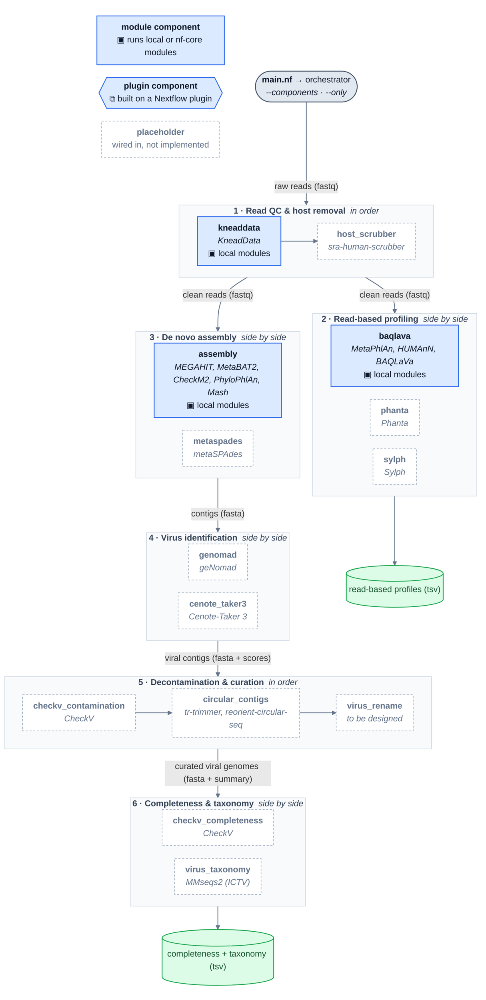

# HVP-nextflow

> Human Virome Project workflows in Nextflow: an orchestrator over pluggable
> read-based and assembly-based virome components, built on
> [biobakery-nextflow](https://github.com/biobakery/biobakery-nextflow).

This repository carries only what HVP needs from biobakery-nextflow: KneadData,
MetaPhlAn, HUMAnN, BAQLaVa and the assembly pipeline. On top of those it adds an
orchestrator that runs **components** stage by stage. Tools that are planned but
not yet implemented sit in the pipeline as placeholders, each with its slot,
contract and TODO, so whoever implements one only touches that component.

## Architecture

<!-- generated:architecture -->
<!-- written by bin/make_diagrams.py from conf/components.json; do not edit by hand -->

<!-- /generated:architecture -->

Blue boxes are ready, and dashed boxes are placeholders. Rectangles (`▣`) are
module components, built from local or nf-core modules. Hexagons (`⧉`) are
plugin components, built on a Nextflow plugin. The diagram is generated
from `conf/components.json` and the code by `bin/make_diagrams.py`. CI fails if
it is stale. [docs/architecture.md](docs/architecture.md) explains the layers,
the stage contracts and how to add a component.

## Components

<!-- generated:components -->
<!-- written by bin/make_diagrams.py from conf/components.json; do not edit by hand -->
| Stage | Component | Status | Tools | Implemented as | What it does |
|---|---|---|---|---|---|
| 1 · Read QC & host removal | `kneaddata` | ready | KneadData | ▣ local modules: `kneaddata` | Trim reads and remove host reads |
| 1 · Read QC & host removal | `host_scrubber` | placeholder | sra-human-scrubber | — | Scrub residual human reads |
| 2 · Read-based profiling | `baqlava` | ready | MetaPhlAn, HUMAnN, BAQLaVa | ▣ local modules: `baqlava`, `humann`, `humann_merge`, `humann_regroup` +3 | Bacterial depletion, then viral profiling |
| 2 · Read-based profiling | `phanta` | placeholder | Phanta | — | Virus-inclusive k-mer profiling |
| 2 · Read-based profiling | `sylph` | placeholder | Sylph | — | Containment-based profiling |
| 3 · De novo assembly | `assembly` | ready | MEGAHIT, MetaBAT2, CheckM2, PhyloPhlAn, Mash | ▣ local modules: `abundance`, `align_and_depth`, `checkm2`, `mash` +3 | Contigs, plus MAG binning and SGB clustering |
| 3 · De novo assembly | `metaspades` | placeholder | metaSPAdes | — | Alternative short-read assembler |
| 4 · Virus identification | `genomad` | placeholder | geNomad | — | Viral contigs and proviruses |
| 4 · Virus identification | `cenote_taker3` | placeholder | Cenote-Taker 3 | — | Hallmark-gene virus discovery |
| 5 · Decontamination & curation | `checkv_contamination` | placeholder | CheckV | — | Trim host regions from proviruses |
| 5 · Decontamination & curation | `circular_contigs` | placeholder | tr-trimmer, reorient-circular-seq | — | Trim DTRs and reorient circular genomes |
| 5 · Decontamination & curation | `virus_rename` | placeholder | to be designed | — | Stable IDs and a per-genome summary table |
| 6 · Completeness & taxonomy | `checkv_completeness` | placeholder | CheckV | — | Genome completeness estimates |
| 6 · Completeness & taxonomy | `virus_taxonomy` | placeholder | MMseqs2 (ICTV) | — | ICTV taxonomic assignment |
<!-- /generated:components -->

## Quick start

Harvard FASRC, everything that is ready (KneadData → BAQLaVa, and assembly).
The pipeline needs Nextflow ≥ 25.10.4, the current nf-core standard. The
hutlab launcher is 24.10.4, so set `NXF_VER`; it downloads 25.10.4 on first use:

```sh
source /n/lab_storage/huttenhower_lab/tools/hutlab/src/hutlabrc_rocky8.sh
hutlab load rocky8/biobakery-workflows-nextflow/0.0.4    # Nextflow launcher + JDK
export NXF_VER=25.10.4

nextflow run main.nf -profile harvard_rc \
  --readsdir /path/to/fastqs \
  --outdir   /path/to/output \
  -w         /path/to/output/work
```

Keep the work directory on shared storage: compute nodes cannot see a login
node's `/tmp`.

### Choosing components

```sh
# Read-based profiling only
--components kneaddata,baqlava

# Reads already clean: skip KneadData (pairs are concatenated for the profilers)
--components baqlava,assembly

# BAQLaVa without HUMAnN
--baqlava_humann false

# One component on its own. genomad needs contigs, so the
# assembly component is added automatically. genomad is still a placeholder.
--only genomad
```

### Demo (bundled single-end sample)

```sh
nextflow run main.nf -profile harvard_rc \
  --readsdir tests/data/single_end_rawfastq --single_end true \
  --components kneaddata,baqlava --baqlava_bypass_depletion true \
  --outdir tests/results/demo
```

### Help and parameters

```sh
nextflow run main.nf --help                 # every parameter, from nextflow_schema.json
nextflow run main.nf --help components      # one parameter in detail
nextflow run main.nf --version
```

Parameters are validated against `nextflow_schema.json` at launch by the
[nf-schema](https://nextflow-io.github.io/nf-schema/) plugin, through the
standard nf-core utility subworkflows. Turn that off with
`--validate_params false`. Defaults live in `conf/params.config`.

## nf-core and Nextflow plugins

- **nf-core library.** `subworkflows/nf-core/` holds `utils_nextflow_pipeline`,
  `utils_nfcore_pipeline` and `utils_nfschema_plugin`, installed from
  [nf-core/modules](https://github.com/nf-core/modules) and pinned in
  `modules.json`. Update them with `nf-core subworkflows update`. nf-core tool
  modules go in `modules/nf-core/` (`nf-core modules install <tool>`).
- **Nextflow plugins.** Every plugin the pipeline loads is declared in the
  `plugins { }` block of `nextflow.config`: nf-schema, plus any plugin a
  component is built on. A component lists the plugins it needs in
  `conf/components.json`, and CI checks they're declared. For a one-off plugin,
  use `-plugins nf-<name>@<version>`.

See [docs/architecture.md](docs/architecture.md#adding-a-component) for the
three ways to implement a component: nf-core module, local module or Nextflow
plugin.

## Layout

```
main.nf                                  entry: init → BIOBAKERY_HVP → completion
workflows/hvp.nf                         the orchestrator (six stages)
subworkflows/nf-core/                    nf-core utility subworkflows (pinned in modules.json)
subworkflows/local/
  utils_hvp_pipeline/                    init/completion on the nf-core utils; input channel; component registry
  components/<name>/main.nf              one component each: ready or placeholder
  read_input/ taxonomic_profiling/ functional_profiling/   shared building blocks
modules/local/<tool>/main.nf             one process per tool invocation
conf/components.json                     the component registry (stages, status, plugins)
modules.json                             nf-core modules/subworkflows and their pinned commits
conf/params.config                       every parameter's default
conf/base.config                         default resources per process
conf/profiles/, conf/databases/          per-site runtime and database paths
nextflow_schema.json                     parameter schema (nf-schema)
bin/make_diagrams.py                     generates the diagram and tables above
```

## Configuration

Settings are layered. Later layers win:

1. `conf/params.config`: every parameter's default
2. `conf/base.config`: default resources, capped by `--max_memory/cpus/time`
3. `conf/profiles/<site>.config`: executor, queue and tool modules (`-profile`)
4. `conf/databases/<site>.config`: database paths for that site (`-profile`)
5. `-params-file my-run.yaml`: this run (`conf/harvard_rc.yaml` is a template)
6. `--param value` on the command line

Profiles: `harvard_rc` (FASRC, SLURM + hutlab modules), `tufts_hpc` (SLURM +
Apptainer), `local`, and `amazon` (incomplete). Where each tool's software comes
from is in [docs/dependencies.md](docs/dependencies.md).

## Output

```
<outdir>/
  kneaddata/        clean reads, read count table
  metaphlan/        per-sample and merged taxonomic profiles
  humann/           gene families, pathways, ECs, merged tables
  baqlava/          per-sample viral profiles
  assembly/         contigs and contig depths
  bins/ checkm/ phylophlan/ sgbs/ abundance_*/   MAGs, quality, placement, SGB clusters
  pipeline_info/    pipeline_log.txt (versions, databases, components), timeline, report, trace
```

## Testing

```sh
bin/make_diagrams.py --check         # registry, code and docs agree (Python only)
bin/check_profile_resources.py       # no profile drops a resource request
sbatch tests/submit_tests.sh         # integration suite on FASRC (tools + databases)
```

CI runs the first two plus `nextflow run -preview` for the default, read-only,
no-QC and `--only` selections. That builds the whole graph without running a task.

## History

Forked from biobakery-nextflow 0.0.4; see [HISTORY.md](HISTORY.md).
