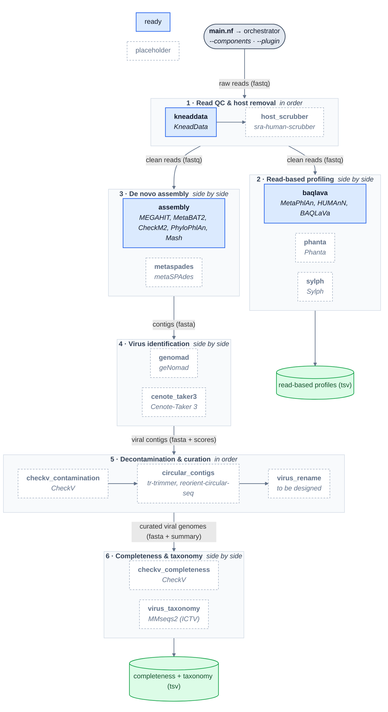

# Architecture

HVP is two things: an **orchestrator** that knows the order of the work, and
**components** that do the work. The orchestrator never runs a tool; a
component never decides what runs after it.

<!-- generated:architecture -->
<!-- written by bin/make_diagrams.py from conf/components.json; do not edit by hand -->

<!-- /generated:architecture -->

Blue boxes run real tools today; dashed boxes are placeholders, wired in but
empty (see below). An arrow is a hand-off of data between stages, labelled with
what is handed over.

## Layers

| Layer | Where | Job |
|---|---|---|
| Entry | `main.nf` | nf-core shape: `PIPELINE_INITIALISATION` → `BIOBAKERY_HVP` → `PIPELINE_COMPLETION`. Resolves `--components` / `--plugin` into a list of component names. |
| Plumbing | `subworkflows/local/utils_hvp_pipeline/` | Parameter validation and `--help` (nf-schema, `nextflow_schema.json`), the input read channel, the component registry and dependency resolution. |
| Orchestrator | `workflows/hvp.nf` | Six stages in a fixed order. Each stage runs whichever of its components were selected and passes one channel on to the next stage. |
| Components | `subworkflows/local/components/<name>/` | One tool, or a small group of tools, behind a fixed per-stage contract. |
| Shared blocks | `subworkflows/local/{read_input,taxonomic_profiling,functional_profiling}/` | Pieces more than one component may reuse. |
| Modules | `modules/local/<tool>/` | One process per tool invocation. |
| Registry | `conf/components.json` | Every stage and component, with its status. Read at launch and by `bin/make_diagrams.py`. |

## Stages

A stage reads one kind of data and writes the next one.

- **Chain** stages (preprocess, virus curation) run their components one
  after another. With nothing selected, the stage passes its input straight
  through, so leaving out `host_scrubber` or `circular_contigs` is fine.
- **Parallel** stages (everything else) give the same input to every selected
  component and mix their outputs. With nothing selected the stage produces
  nothing, so anything downstream of it needs one of them.

## Choosing what runs

```sh
# Default: every ready component
--components kneaddata,baqlava,assembly

# Read-based profiling only, no assembly
--components kneaddata,baqlava

# Skip read QC (reads are already clean). Pairs are concatenated for the profilers.
--components baqlava

# One component on its own: a plugin run
--plugin genomad
```

`--plugin x` runs component `x` plus the preprocessing components named in
`--components`. In both modes, a component whose input nothing produces gets
the producing stage's default component added, and the run logs it. For
example, `--plugin genomad` needs contigs, so `assembly` is added:

```
[hvp] 'genomad' needs contigs (fasta): adding 'assembly' (De novo assembly).
[hvp] Components: kneaddata -> assembly -> genomad  (plugin mode: genomad)
```

## Component contracts

Every component in a stage has the same `take:` / `emit:` shape. That is what
lets the orchestrator wire a new component with three lines.

| Stage | take | emit |
|---|---|---|
| preprocess | `reads` `[meta, fastq]`, `parts` `[id, [mates]]` | `reads`, `parts` (same shapes) |
| read_profiling | `reads` `[meta, fastq]` | `profiles` `[[id, tool], file]` |
| assembly | `reads` `[meta, fastq]`, `parts` `[id, [mates]]` | `contigs` `[[id, assembler], fasta]` |
| virus_identification | `contigs` | `viral_contigs` `[[id, assembler, caller], fasta]`, `scores` |
| virus_curation | `genomes` `[meta, fasta]` | `genomes` (same shape), `report` |
| characterisation | `genomes` | `annotations` `[[id, tool], tsv]` |

`meta` on reads is `[id: sample, paired_end: bool]`. `parts` holds the separate
mates of paired samples (KneadData's four outputs, or the raw `[R1, R2]` when
there is no QC), for assemblers that want them.

## Components

<!-- generated:components -->
<!-- written by bin/make_diagrams.py from conf/components.json; do not edit by hand -->
| Stage | Component | Status | Tools | What it does |
|---|---|---|---|---|
| 1 · Read QC & host removal | `kneaddata` | ready | KneadData | Trim reads and remove host reads |
| 1 · Read QC & host removal | `host_scrubber` | placeholder | sra-human-scrubber | Scrub residual human reads |
| 2 · Read-based profiling | `baqlava` | ready | MetaPhlAn, HUMAnN, BAQLaVa | Bacterial depletion, then viral profiling |
| 2 · Read-based profiling | `phanta` | placeholder | Phanta | Virus-inclusive k-mer profiling |
| 2 · Read-based profiling | `sylph` | placeholder | Sylph | Containment-based profiling |
| 3 · De novo assembly | `assembly` | ready | MEGAHIT, MetaBAT2, CheckM2, PhyloPhlAn, Mash | Contigs, plus MAG binning and SGB clustering |
| 3 · De novo assembly | `metaspades` | placeholder | metaSPAdes | Alternative short-read assembler |
| 4 · Virus identification | `genomad` | placeholder | geNomad | Viral contigs and proviruses |
| 4 · Virus identification | `cenote_taker3` | placeholder | Cenote-Taker 3 | Hallmark-gene virus discovery |
| 5 · Decontamination & curation | `checkv_contamination` | placeholder | CheckV | Trim host regions from proviruses |
| 5 · Decontamination & curation | `circular_contigs` | placeholder | tr-trimmer, reorient-circular-seq | Trim DTRs and reorient circular genomes |
| 5 · Decontamination & curation | `virus_rename` | placeholder | to be designed | Stable IDs and a per-genome summary table |
| 6 · Completeness & taxonomy | `checkv_completeness` | placeholder | CheckV | Genome completeness estimates |
| 6 · Completeness & taxonomy | `virus_taxonomy` | placeholder | MMseqs2 (ICTV) | ICTV taxonomic assignment |
<!-- /generated:components -->

## Adding a component

A placeholder becomes real in place: only its own `main.nf` changes, plus the
registry status. To implement `genomad`, for example:

1. Write the module(s) under `modules/local/` (or install an nf-core module
   under `modules/nf-core/` with `nf-core modules install genomad/endtoend`).
2. In `subworkflows/local/components/genomad/main.nf`, add a `main:` block
   with the real calls, and replace the `Channel.empty()` emits.
   Keep the `take:` / `emit:` names: they are the stage contract.
3. In `conf/components.json`, set `"status": "ready"`, and update the
   `// Component: … status:` header line to match.
4. Add resources for the new processes in `conf/base.config` and the module
   environment in each site profile.
5. Run `bin/make_diagrams.py` and commit the result. The box turns blue.

A brand-new component works the same way. Add an entry to
`conf/components.json`, create `subworkflows/local/components/<name>/main.nf`
to its stage's contract, and add an include plus one `if (on('<name>'))` block
in its stage in `workflows/hvp.nf`. `bin/make_diagrams.py --check` (run in CI)
fails if any of these three disagree.

## Generated files

`bin/make_diagrams.py` writes `docs/diagrams/architecture.mmd`, plus the
diagram and component table on this page and in the README. It reads only
`conf/components.json` and the component and orchestrator sources, so it needs
Python and nothing else. `--render` also writes `docs/diagrams/architecture.svg` and `.png`.
